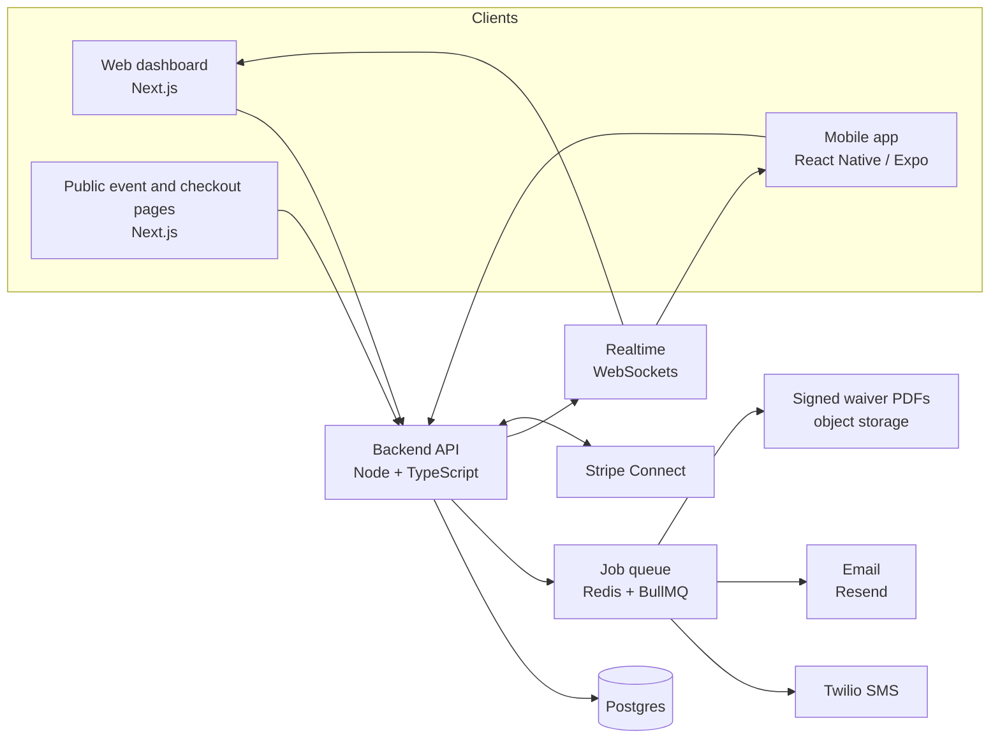

# Ticketing App: Build Plan

Draft for Tim's review, 2026-10-19. Nothing is being coded until this plan is approved.

## What we're building

Online ticketing for school events where minors attend (after-prom first, then dances, homecoming, plays and booster events). The product wins on safety and compliance, not on fees:

- tickets sold online with the **waiver built into checkout**, including a **guardian signature** for minors
- **QR check-in and check-out** at the door from a phone app
- a **text to the parent** when their student checks in and when they leave
- one live attendee list for staff, then **district accounts** and **silent auctions** later

The business case is in the project files under `ticketing-research/ticket-committee-assessment.md`. Target customer order: after-prom committees, then schools, then districts. General-admission events (bars, festivals) are out of scope for now so the "safe student events" story stays sharp.

## The apps

| App                            | Who uses it                                      | What it does                                                                                                                 |
| ------------------------------ | ------------------------------------------------ | ---------------------------------------------------------------------------------------------------------------------------- |
| **Backend API**                | Everything below                                 | Orgs, events, tickets, orders, waivers, check-ins, notifications, auctions. Single source of truth.                          |
| **Web: Dashboard**             | Committee members, school staff, district admins | Set up events, tickets and waivers; manage attendees; watch event night live; reports; billing.                              |
| **Web: public pages**          | Students and parents                             | Event page, checkout, waiver and guardian signing. No app install needed to buy a ticket.                                    |
| **Mobile app (iOS + Android)** | Door staff first; later students and parents     | Scan QR to check in and out, offline at the door. Later: ticket wallet, in-app waivers, parent status view, auction bidding. |

Buying happens on the web on purpose: parents can sign from a text link without installing anything, and event tickets are exempt from App Store in-app purchase rules either way.

## Architecture

### Recommended stack (default unless Tim prefers otherwise)

| Layer    | Choice                                                                                                            | Why                                                                                            |
| -------- | ----------------------------------------------------------------------------------------------------------------- | ---------------------------------------------------------------------------------------------- |
| Language | **TypeScript everywhere**                                                                                         | One language across API, web and mobile; shared types and validation in `packages/shared`.     |
| Repo     | **Monorepo** (pnpm + Turborepo) in `TBSoftware-hub/TicketApp`                                                     | One PR can change API and both clients together.                                               |
| Backend  | **Node.js with Fastify** (or NestJS), **Prisma**, **Postgres**                                                    | Boring, well-supported, easy to host.                                                          |
| Web      | **Next.js (React)**                                                                                               | Dashboard and public pages in one app; server rendering for fast event pages.                  |
| Mobile   | **React Native with Expo**                                                                                        | One codebase for iOS and Android; EAS builds and over-the-air updates; good camera/QR support. |
| Payments | **Stripe Connect** (Express accounts)                                                                             | Money goes straight to each org; optional platform fee per ticket; Apple Pay and Google Pay.   |
| SMS      | **Twilio** (registered 10DLC number)                                                                              | Reliable delivery receipts, STOP/HELP handling, needed for TCPA compliance.                    |
| Email    | **Resend**                                                                                                        | Ticket and waiver emails.                                                                      |
| Jobs     | **Redis + BullMQ**                                                                                                | Texts, emails, reminders and PDF generation run off the request path with retries.             |
| Realtime | **WebSockets**                                                                                                    | Live headcount, multi-device door sync, auction bidding.                                       |
| Hosting  | Managed: e.g. Render or Fly.io for API/workers, Vercel for web, managed Postgres and Redis, S3-compatible storage | Low ops for a small team; move to AWS later if a district requires it.                         |
| Quality  | GitHub Actions CI, Sentry, Playwright (web), Jest                                                                 | Every PR is checked before merge.                                                              |

### Core data model

`Organization` (school, committee, nonprofit; belongs to an optional `District`) → `Event` → `TicketType` → `Order` → `Ticket` (one per attendee, carries the QR code). `Attendee` holds student details and links to one or more `Guardian`s. `WaiverTemplate` → `WaiverSignature` (signer, role student/guardian, timestamp, IP, document hash, PDF). `ScanEvent` records every check-in/check-out with device and staff. `Notification` records every text/email with delivery status. `Auction` → `AuctionItem` → `Bid` come in Phase 3.

### Safety and compliance built in from day one

- Student data is minimised, encrypted at rest, and deletable per org; retention settings arrive with district accounts.
- Every parent text has a delivery status; failed texts surface to staff on the live dashboard instead of failing silently.
- Waiver signatures keep an audit trail so a signed PDF holds up for the venue and vendors.
- Staff overrides at the door (e.g. missing waiver) require a reason and are logged.

## Phases

| Phase                                      | Goal                                           | Done when                                                                                                                                                                    |
| ------------------------------------------ | ---------------------------------------------- | ---------------------------------------------------------------------------------------------------------------------------------------------------------------------------- |
| **0. Foundations**                         | Repo, CI, environments, sign-in, organizations | A staff member can sign in, create an org and invite a teammate on staging.                                                                                                  |
| **1. MVP: run an after-prom**              | Everything one committee needs for one event   | A test after-prom runs end to end: tickets bought with waivers and guardian signatures, students scanned in and out on iOS and Android, parents texted, staff watch it live. |
| **2. Schools, districts and attendee app** | What a school and district will pay for        | A district can run events across schools with SSO, reports, data controls and a paid plan; students carry tickets in the app.                                                |
| **3. Auctions and fundraising**            | Silent auctions and donations                  | 80+ bidders can bid live from phones and winners are charged automatically.                                                                                                  |
| **4. Launch and growth**                   | Self-serve signup and marketing                | A school can find the product, sign up and run an event without help.                                                                                                        |

**Timing goal:** after-prom buying runs roughly January to April, so Phase 1 should be ready for a pilot committee by **late January 2027**. Phase 2 can follow during the spring season, and auctions after that. The board shows real progress against this.

## How we'll work

- Each story becomes one or a few pull requests on `TBSoftware-hub/TicketApp`, each with CI green before merge.
- The [Kanban board](https://claude.ai/artifact/4JRB7iwyhK1K6mNgW3Cmsx) tracks every epic and story with status (Backlog, To do, In progress, In review, Done). Claude moves cards as work starts, PRs open and PRs merge; Tim can also drag cards himself.
- Phases are built in order, but stories inside a phase can run in parallel (for example the check-in app and the dashboard).

## Decisions for Tim

1. **Stack:** TypeScript monorepo with Next.js web and React Native/Expo mobile (recommended), or something else?
2. **Parents in Phase 1:** text messages only (recommended), with the parent app view in Phase 2?
3. **Payments:** Stripe Connect with money going straight to each org, plus an optional per-ticket fee the org can pass to buyers (recommended)?
4. **Product name and domain**, needed for the app stores, the Twilio number registration and Stripe.

## Accounts we'll need before Phase 1

Apple Developer ($99/year), Google Play Console ($25 once), Stripe, Twilio (with 10DLC brand and campaign registration, which takes a while to approve), Resend, a hosting provider and a domain.

## Epics and stories

### E0 Planning (Phase 0)

Build plan, architecture and this board.

| ID   | Story                                          | App | Status |
| ---- | ---------------------------------------------- | --- | ------ |
| E0.1 | Write build plan: architecture, epics, phasing | All | done   |
| E0.2 | Publish Kanban board                           | All | done   |
| E0.3 | Tim reviews and approves the plan              | All | review |

### E1 Foundations & DevOps (Phase 0)

Monorepo, CI, environments, observability.

| ID   | Story                                                                            | App   | Status |
| ---- | -------------------------------------------------------------------------------- | ----- | ------ |
| E1.1 | Monorepo with pnpm + Turborepo: apps/api, apps/web, apps/mobile, packages/shared | Infra | todo   |
| E1.2 | CI on every PR: lint, typecheck, unit tests                                      | Infra | todo   |
| E1.3 | Postgres schema and migrations (Prisma) with seed data                           | API   | todo   |
| E1.4 | Staging and production environments with deploy pipeline                         | Infra | todo   |
| E1.5 | Error tracking and structured logging (Sentry)                                   | Infra | todo   |
| E1.6 | Shared design tokens and UI kit for web and mobile                               | Web   | todo   |

### E2 Accounts & Organizations (Phase 0)

Staff sign-in, orgs, roles.

| ID   | Story                                                              | App | Status |
| ---- | ------------------------------------------------------------------ | --- | ------ |
| E2.1 | Staff sign-up and sign-in (email magic link)                       | API | todo   |
| E2.2 | Create organization: school, committee or nonprofit, with branding | Web | todo   |
| E2.3 | Invite teammates with roles: Owner, Admin, Door staff, Viewer      | Web | todo   |
| E2.4 | Role-based access control enforced in the API                      | API | todo   |
| E2.5 | Guest checkout for buyers (no account needed)                      | API | todo   |

### E3 Events & Ticket Setup (Phase 1)

Create events and ticket types in the dashboard.

| ID   | Story                                                               | App | Status |
| ---- | ------------------------------------------------------------------- | --- | ------ |
| E3.1 | Create and edit an event: date, venue, capacity, description, image | Web | todo   |
| E3.2 | Ticket types with price, quantity, sale window and per-order limits | Web | todo   |
| E3.3 | Eligibility rules: students only, grade, guest-pass approval        | API | todo   |
| E3.4 | Public event page, shareable and mobile friendly                    | Web | todo   |
| E3.5 | Promo codes and comp tickets                                        | Web | todo   |

### E4 Checkout & Payments (Phase 1)

Stripe Connect payments straight to each org.

| ID   | Story                                                          | App    | Status |
| ---- | -------------------------------------------------------------- | ------ | ------ |
| E4.1 | Stripe Connect onboarding for each organization                | API    | todo   |
| E4.2 | Checkout with Stripe Payment Element, Apple Pay and Google Pay | Web    | todo   |
| E4.3 | Order confirmation email with QR ticket                        | API    | todo   |
| E4.4 | Refunds and cancellations from the dashboard                   | Web    | todo   |
| E4.5 | Optional per-ticket fee passed to the buyer                    | API    | todo   |
| E4.6 | Stripe webhooks, payout reporting and reconciliation           | API    | todo   |
| E4.7 | Record cash and door sales                                     | Mobile | todo   |

### E5 Waivers & Guardian Consent (Phase 1)

The hero feature: waivers signed inside the ticket purchase.

| ID   | Story                                                                 | App | Status |
| ---- | --------------------------------------------------------------------- | --- | ------ |
| E5.1 | Waiver template builder with required fields                          | Web | todo   |
| E5.2 | Attach waivers to ticket types; student completes them at checkout    | Web | todo   |
| E5.3 | Guardian signature request by text or email link for minors           | API | todo   |
| E5.4 | E-signature with audit trail (time, IP, document hash) and signed PDF | API | todo   |
| E5.5 | Waiver status on each ticket plus automatic reminders                 | API | todo   |
| E5.6 | Emergency contact and medical notes capture                           | Web | todo   |
| E5.7 | Waiver export bundle for vendors (PDF and CSV)                        | Web | todo   |

### E6 Attendee Management (Phase 1)

One attendee list for the whole event.

| ID   | Story                                                      | App | Status |
| ---- | ---------------------------------------------------------- | --- | ------ |
| E6.1 | Attendee list with search and filters (waiver, checked in) | Web | todo   |
| E6.2 | Import student roster from CSV for eligibility             | Web | todo   |
| E6.3 | Edit attendee, transfer or resend a ticket                 | Web | todo   |
| E6.4 | Export attendees to CSV                                    | Web | todo   |

### E7 Door Check-in App (Phase 1)

iOS and Android app for door staff.

| ID   | Story                                                                | App    | Status |
| ---- | -------------------------------------------------------------------- | ------ | ------ |
| E7.1 | Expo app shell with staff sign-in and event picker                   | Mobile | todo   |
| E7.2 | QR scanner with instant valid, invalid or already-used result        | Mobile | todo   |
| E7.3 | Block entry when a waiver is missing, with staff override and reason | Mobile | todo   |
| E7.4 | Check-out scan and re-entry rules                                    | Mobile | todo   |
| E7.5 | Manual lookup by name                                                | Mobile | todo   |
| E7.6 | Offline mode: cached attendee list and sync queue                    | Mobile | todo   |
| E7.7 | Real-time sync across several door devices                           | API    | todo   |
| E7.8 | TestFlight and Play internal testing, then store release             | Mobile | todo   |

### E8 Parent Notifications (Phase 1)

Texts to guardians when a student checks in or out.

| ID   | Story                                                      | App | Status |
| ---- | ---------------------------------------------------------- | --- | ------ |
| E8.1 | Guardian phone capture with SMS opt-in consent (TCPA)      | Web | todo   |
| E8.2 | Check-in text to guardian                                  | API | todo   |
| E8.3 | Check-out text with time, and left-early alert             | API | todo   |
| E8.4 | Delivery tracking, retries and failed-text alerts to staff | API | todo   |
| E8.5 | STOP and HELP handling; email fallback                     | API | todo   |

### E9 Live Event Dashboard (Phase 1)

What staff watch on event night.

| ID   | Story                                            | App | Status |
| ---- | ------------------------------------------------ | --- | ------ |
| E9.1 | Live headcount: inside, checked out, not arrived | Web | todo   |
| E9.2 | Live activity feed of scans                      | Web | todo   |
| E9.3 | Missing-waiver and no-show lists                 | Web | todo   |
| E9.4 | Post-event report: attendance, revenue, waivers  | Web | todo   |

### E10 Attendee & Parent App (Phase 2)

Tickets, waivers and student status in the mobile app.

| ID    | Story                                             | App    | Status  |
| ----- | ------------------------------------------------- | ------ | ------- |
| E10.1 | Ticket wallet with offline QR                     | Mobile | backlog |
| E10.2 | Apple Wallet and Google Wallet passes             | API    | backlog |
| E10.3 | Sign waivers in the app                           | Mobile | backlog |
| E10.4 | Push notifications                                | Mobile | backlog |
| E10.5 | Guardian view of a student's live check-in status | Mobile | backlog |

### E11 Schools & Districts (Phase 2)

What districts need to buy.

| ID    | Story                                                         | App | Status  |
| ----- | ------------------------------------------------------------- | --- | ------- |
| E11.1 | District account with many schools                            | API | backlog |
| E11.2 | District admin dashboard with roll-up reports                 | Web | backlog |
| E11.3 | Staff SSO with Google Workspace and Microsoft                 | API | backlog |
| E11.4 | Student-data controls: retention, deletion, DPA-ready (FERPA) | API | backlog |
| E11.5 | Audit log of staff actions                                    | API | backlog |
| E11.6 | Subscription plans and billing: Starter, School, District     | Web | backlog |

### E12 Silent Auctions (Phase 3)

Phone bidding for fundraisers.

| ID    | Story                                                          | App    | Status  |
| ----- | -------------------------------------------------------------- | ------ | ------- |
| E12.1 | Create auction and items with photos, starting bid, increments | Web    | backlog |
| E12.2 | Bidder registration with card on file                          | Web    | backlog |
| E12.3 | Live bidding on phone with real-time updates                   | Mobile | backlog |
| E12.4 | Outbid notifications by text and push                          | API    | backlog |
| E12.5 | Auction close, charge winners, send receipts                   | API    | backlog |
| E12.6 | Live auction totals on the dashboard                           | Web    | backlog |
| E12.7 | Donations and fund-a-need                                      | Web    | backlog |

### E13 Launch & Growth (Phase 4)

Get it in front of schools.

| ID    | Story                                        | App | Status  |
| ----- | -------------------------------------------- | --- | ------- |
| E13.1 | Marketing site with demo request             | Web | backlog |
| E13.2 | Self-serve onboarding wizard and help center | Web | backlog |
| E13.3 | Product analytics                            | All | backlog |
| E13.4 | Vendor referral program                      | Web | backlog |
| E13.5 | Security review and accessibility audit      | All | backlog |
